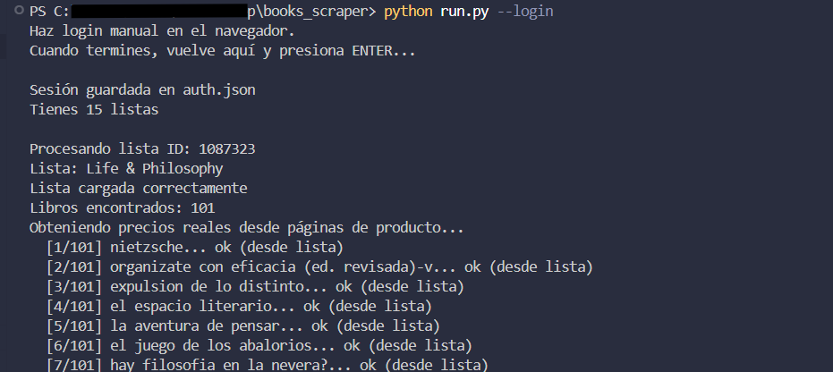
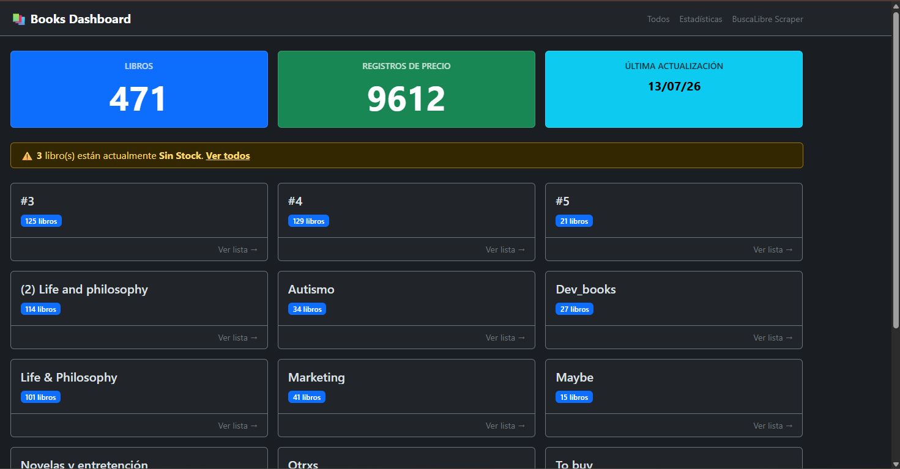
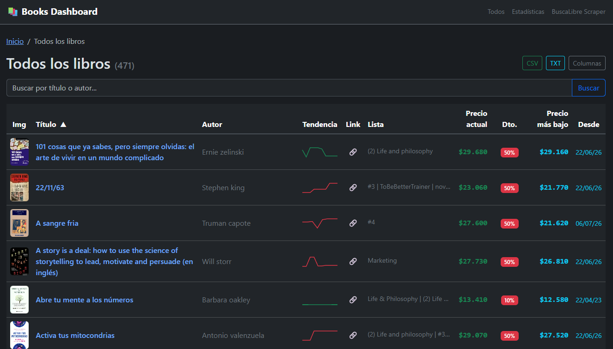
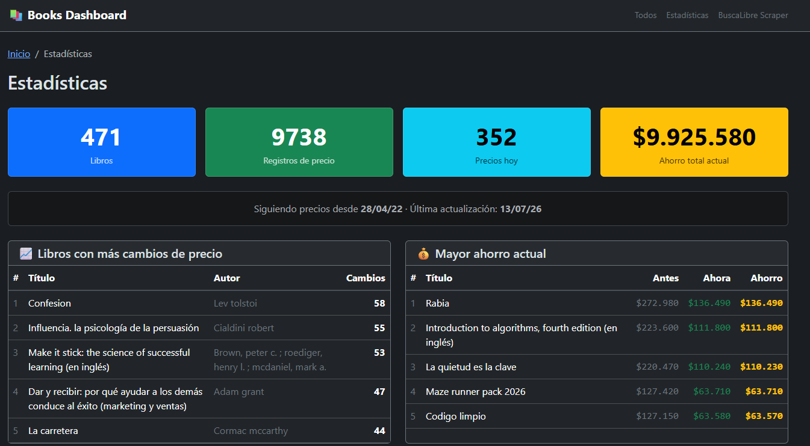
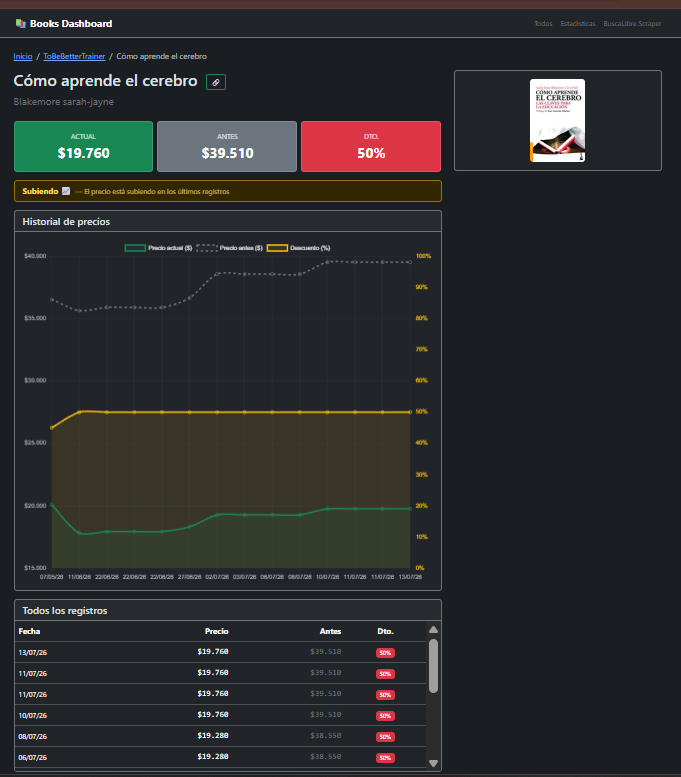
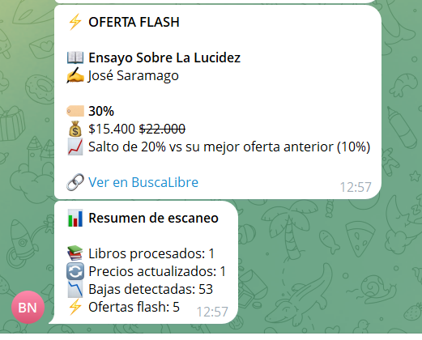
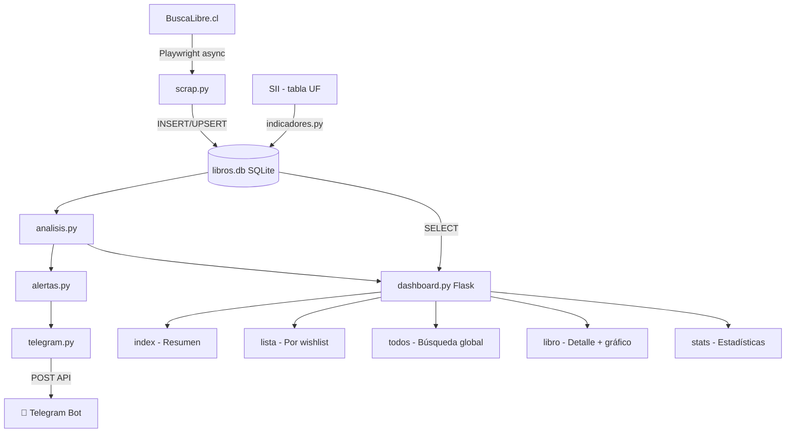

# Books Scraper — BuscaLibre.cl


Scraper de precios para listas de deseos de **BuscaLibre.cl** con historial, dashboard web y notificaciones por Telegram.

---

## Features

- **Scraping automático** — Obtiene precios de tus wishlists de BuscaLibre
- **Optimizado** — Usa precios visibles en la lista; solo visita páginas individuales cuando faltan datos
- **Historial de precios** — Cada precio queda registrado con fecha, descuento y estado (disponible / sin stock)
- **¿Es buena rebaja?** — Cada libro se evalúa contra su propio historial: *Mínimo histórico* (ajustado por inflación con la UF), *Mínimo del año*, *Buen precio*, *Normal* o *Caro*
- **Eventos de rebaja de la tienda** — Detecta los días en que el descuento medio de todo el catálogo supera lo habitual (p. ej. *"El 06/10/26 fue una buena rebaja de la tienda: descuento medio 45,3% vs 41,6% habitual"*)
- **Alertas Telegram sin ruido** — Un mensaje agrupado con los libros en nuevo mínimo del año (≥3%), aviso del primer día de cada rebaja de tienda y resumen semanal; avisos de fallo o sesión expirada
- **Dashboard web** — Flask + Chart.js + sparklines inline SVG, con filtro "Solo buenos precios"
- **Múltiples listas** — Soporte para varias wishlists con organización N:M, sincronizadas con BuscaLibre
- **Export CSV / TXT** — Descarga de datos completa
- **Migraciones seguras** — Limpieza de datos versionada con backup, verificación y `--dry-run`

---

## Demo

### Terminal — Ejecución del scraper



### Dashboard principal



### Todos los libros



### Estadísticas



### Detalle de libro con gráfico de precios



### Notificación por Telegram (formato anterior a v2.0)



---

## Stack

| Capa           | Tecnología                                  |
| -------------- | ------------------------------------------- |
| Scraping       | Python · Playwright (async) · BeautifulSoup |
| Backend        | Flask · SQLite                              |
| Frontend       | Bootstrap 5 · Chart.js · Sparklines SVG     |
| Análisis       | Python puro (percentiles, mediana/MAD)      |
| Indicadores    | UF diaria desde la tabla oficial del SII    |
| Notificaciones | Telegram Bot API                            |
| Automatización | Windows Task Scheduler / GitHub Actions     |
| Calidad        | pytest · pip-audit en CI                    |

---

## Quick Start

```bash
# 1. Clonar
git clone https://github.com/maetenco/books-scraper.git
cd books-scraper

# 2. Dependencias
pip install -r requirements.txt
playwright install chromium

# 3. Configurar Telegram (opcional)
cp .env.example .env
# Editar .env con tu TOKEN y CHAT_ID de @BotFather

# 4. Login manual (primera vez)
python run.py --login

# 5. Ejecutar scraper
python run.py

# 6. Dashboard
python dashboard.py
# Abrir http://localhost:5000
```

---

## Estructura

```
books-scraper/
├── scrap.py          # Scraper principal (Playwright async)
├── analisis.py       # Motor de análisis: evaluación por libro y eventos de tienda
├── alertas.py        # Qué avisar por Telegram y redacción de los mensajes
├── indicadores.py    # UF diaria (SII), cacheada en la DB
├── telegram.py       # Envío a Telegram (escape HTML, rate limit, alertas de fallo)
├── migraciones.py    # Migraciones de datos versionadas (PRAGMA user_version)
├── dashboard.py      # Dashboard web Flask
├── run.py            # Entry point para ejecución
├── utils.py          # Formato de precios y marca de ejecución diaria
├── templates/        # Jinja2 templates
│   ├── layout.html
│   ├── index.html
│   ├── lista.html
│   ├── libro.html
│   ├── todos.html
│   └── stats.html
├── static/
│   ├── style.css
│   └── img/          # Screenshots del proyecto
├── tests/            # Tests con pytest
├── requirements.txt
├── LICENSE
├── .env.example
└── .gitignore
```

---

## Uso

| Comando                                      | Descripción                                                  |
| -------------------------------------------- | ------------------------------------------------------------ |
| `python run.py`                              | Scraping headless + alertas Telegram (una vez al día)        |
| `python run.py --no-telegram`                | Solo scraping, sin notificar                                 |
| `python run.py --login`                      | Modo manual (guarda sesión para headless)                    |
| `python run.py --force`                      | Corre aunque ya se haya ejecutado hoy                        |
| `python run.py --preview-alertas`            | Muestra las alertas que se enviarían, sin scrapear ni enviar |
| `python dashboard.py`                        | Inicia el dashboard web en :5000                             |
| `python scrap.py --headless`                 | Solo scraping (sin run.py)                                   |
| `python analisis.py --backtest`              | Calibración: eventos y nuevos mínimos por día (solo lectura) |
| `python migraciones.py --dry-run`            | Muestra qué cambiaría una migración pendiente                |
| `python migraciones.py`                      | Backup + aplica migraciones pendientes con verificación      |
| `python migraciones.py --reportar-duplicados`| Lista libros distintos con la misma URL                      |
| `python migraciones.py --fusionar ID ID`     | Une dos registros del mismo libro                            |

Todas las herramientas aceptan `BOOKS_DB_PATH=ruta/copia.db` para trabajar sobre una copia de la base de datos.

---

## Arquitectura



---

## Arquitectura & Decisiones

### ¿Por qué Playwright y no Selenium?

Playwright tiene soporte **async nativo** con `asyncio`, lo que permite hacer scraping concurrently sin bloquear. Selenium requiere threads o multiprocessing para lograr algo similar. Además, Playwright incluye **auto-wait** (espera inteligente a que los elementos estén listos), manejo integrado de `storage_state` para persistir sesiones, y es más moderno en su API.

### ¿Por qué SQLite y no una base de datos relacional mayor?

El proyecto es **single-user**. No necesitas concurrencia, usuarios simultáneos ni un servidor de base de datos corriendo 24/7. SQLite es un archivo portable (`libros.db`), cero configuración, y suficiente para miles de registros de precios. Si en el futuro necesitas escalar, la migración a PostgreSQL es directa porque el código ya usa queries SQL estándar.

### Relación N:M entre wishlists y libros

La tabla `libros_listas` permite que **un libro pertenezca a múltiples wishlists** y que **una wishlist contenga muchos libros**. Esto modela la realidad de BuscaLibre, donde puedes tener un libro en "Favoritos" y en "Regalos" simultáneamente. Una relación 1:N habría forzado duplicación de datos.

### Historial append-only vs UPDATE

Cada escaneo crea una **fila nueva** en la tabla `precios` en vez de actualizar la existente. Esto construye un historial completo que alimenta:

- Los **sparklines SVG** inline en el dashboard (tendencia visual sin JavaScript).
- El **gráfico Chart.js** con eje dual (precio + descuento %).
- El **motor de análisis** que decide si un precio es una buena rebaja.

Un libro que está en varias listas registra **un solo precio por corrida**. Si el precio cambia dentro del mismo día (dos corridas), se conservan ambas filas: el criterio de "buena rebaja" es el precio más bajo, y perder un mínimo intradía falsearía el análisis.

### Lazy scraping — optimización de requests

El scraper primero intenta leer el precio desde la **página de la wishlist** (donde BuscaLibre muestra `precioAhora` y `precioAntes`). Solo visita la **página individual del producto** si el precio no está visible o es `None`. Esto reduce significativamente la cantidad de requests y el tiempo de ejecución.

En la página de producto, el **precio se busca primero**: si existe, el libro está disponible aunque aparezca "Sin Stock" en otra parte de la página (p. ej. un carrusel de recomendados). Solo sin precio se mira la marca de agotado del bloque del producto.

### Cómo se decide una "buena rebaja"

La mayoría de los libros son importados y su precio en pesos **oscila casi a diario con el tipo de cambio**: un libro puede tener 30 precios distintos en 50 escaneos. Comparar contra el escaneo anterior ("bajó $500 desde ayer") generaba cientos de alertas falsas. Por eso `analisis.py` compara contra el **historial propio de cada libro** y contra el **comportamiento de toda la tienda**:

**Por libro** (`evaluar_libro`):

| Etiqueta | Criterio |
|---|---|
| 🏆 Mínimo histórico | Precio ≤ al menor de todo el historial, llevando cada precio antiguo a **pesos de hoy con la UF** (p. ej. $15.980 en abril de 2024 equivalen a $17.684 de hoy) |
| ✅ Mínimo del año | Precio ≤ al menor de los 365 días anteriores |
| 👍 Buen precio | Más barato que el 80% de los días del último año |
| Precio normal / 📈 Caro | Percentil intermedio / ≥ 80 |
| Historial corto | Menos de 30 días escaneados: aún no hay con qué comparar |

**Por tienda** (`detectar_eventos`): un día es *evento de rebaja* si el **descuento medio de todo el catálogo** supera su nivel habitual (mediana de los 30 escaneos previos) por más de `max(2 pp, 3 × MAD)`. Mira el % de descuento que fija la tienda, no el precio en pesos, así que no lo confunden las variaciones del dólar. Con los datos reales detecta, por ejemplo, el 18/08/26 (49,4% vs 41,1% habitual) y el 06/10/26 (45,3% vs 41,6%), y deja fuera las caídas de descuento (Fiestas Patrias: 36%).

**Calibración con datos reales**: los umbrales (3% bajo el mínimo anual, 30 días de historial) se eligieron con `python analisis.py --backtest`, que reproduce día por día qué alertas se habrían enviado. Con 10 días de historial, en las primeras semanas casi todo era "mínimo del año"; con 30, las alertas se concentran en los días de rebaja real (~50 en 6 semanas, frente a las 179 "bajas" que llegó a enviar el sistema anterior en un solo día).

**¿Por qué sin LLM?** La decisión es numérica y tiene que ser **reproducible y testeable**: los números los calcula código determinista y los textos salen de plantillas (*"El 06/10/26 fue una buena rebaja de la tienda: descuento medio 45,3% vs 41,6% habitual"*). Sin costo de API, sin enviar datos a terceros y sin riesgo de que un modelo invente cifras.

### Alertas sin ruido

`alertas.py` decide qué avisar y `telegram.py` solo envía:

- **Un mensaje agrupado por corrida** con los libros ≥3% bajo su mínimo del año (máx. 15 + "y N más"), con el evento de tienda al inicio si lo hay (solo el primer día del evento).
- **Resumen semanal** en la primera corrida desde el lunes.
- La tabla `notificaciones` evita repetir avisos; un aviso se registra solo si Telegram lo aceptó, así que un fallo de red se reintenta en la próxima corrida.
- Todo texto externo se escapa (`html.escape`): un título con `&` hacía que Telegram rechazara el mensaje entero.
- Si la corrida falla o la sesión de BuscaLibre expiró, llega un aviso con el motivo (*"ejecuta `python run.py --login`"*).

### UF desde el SII

`indicadores.py` descarga la UF diaria de la tabla oficial anual del SII (gratis, sin API key) y la guarda en la tabla `uf`; solo vuelve a pedir lo que falta. Si el SII no responde, el scraping sigue y el dashboard simplemente omite el nivel "ajustado por inflación".

### Schema migration sin framework

Los cambios de **esquema** se hacen con `CREATE TABLE IF NOT EXISTS` y `ALTER TABLE ... ADD COLUMN` idempotentes en `crear_tablas()` (`scrap.py`), sin ORM ni dependencias extra.

Los cambios de **datos** (p. ej. borrar filas duplicadas) van en `migraciones.py`, versionados con `PRAGMA user_version` (nativo de SQLite). Nunca corren solos: se ejecutan a mano, hacen backup previo, corren en una transacción con verificación de invariantes (si no cuadra, rollback) y tienen `--dry-run`. La migración 1 borró 38.531 filas idénticas del mismo día (66.271 → 27.740) sin perder ningún día de historial de ningún libro.

---

## Changelog

| Versión | Descripción |
|---------|-------------|
| v0.1 | Scraping básico de precios con Playwright |
| v0.2 | Historial de precios + SQLite (append-only) |
| v0.3 | Notificaciones Telegram (bajas + flash deals; reemplazadas en v2.0) |
| v0.4 | Dashboard web (Flask + Chart.js + sparklines) |
| v0.5 | Buy recommendation + export CSV + estadísticas (recomendación reemplazada en v2.0) |
| v0.6 | Tests (pytest) + GitHub Actions CI |
| v1.0 | Portfolio ready: LICENSE, README, docs |
| v1.1 | Integridad de datos: un precio por corrida, migraciones versionadas, sincronización de listas, estadísticas corregidas |
| v1.2 | Robustez: detección de "sin stock" fiable, alertas de fallo y sesión expirada, Telegram con escape HTML y rate limit, dependencias sin vulnerabilidades conocidas (pip-audit en CI) |
| v2.0 | Análisis de rebajas (mínimo del año, mínimo histórico ajustado por UF, eventos de tienda) y alertas sin ruido (nuevo mínimo, evento, resumen semanal) |
